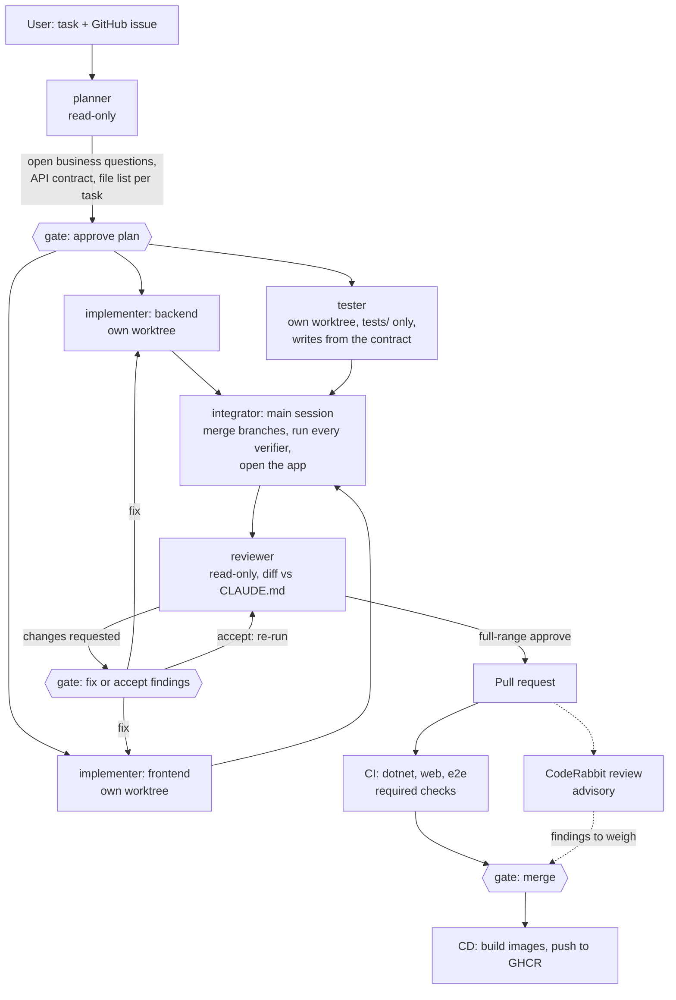

# Mini POS: an AI agent harness for .NET + Angular

[](https://github.com/duytech/MiniPOS/actions/workflows/ci.yml)
[](https://github.com/duytech/MiniPOS/actions/workflows/cd.yml)

A small restaurant point of sale (.NET 10 Clean Architecture API, Angular 20 + Tailwind, PostgreSQL 17), built almost
entirely by AI coding agents. The app is the exercise; the point of the repo is the **harness** around the agents: the
instruction file, skills, scoped sub-agents, hooks and verifiers that keep their output correct, and the AI review
and CI gates a change passes before it reaches `main`.

## What the app does

Orders with lines, tax, tip, discount, card surcharge (dual pricing) and split bill (evenly or by item), with exact
cents everywhere. Business rules: [`docs/business-rules.md`](docs/business-rules.md). Every API route and page, and
the tests that verify it: [`docs/feature-list.json`](docs/feature-list.json).

## The harness at a glance

| Piece | Where |
| --- | --- |
| Project instruction file | [`CLAUDE.md`](CLAUDE.md), plus [`docs/architecture.md`](docs/architecture.md) and [`docs/business-rules.md`](docs/business-rules.md) |
| Skills (repeatable workflows) | [`.claude/skills/add-endpoint`](.claude/skills/add-endpoint), [`add-angular-feature`](.claude/skills/add-angular-feature), [`verify-ui`](.claude/skills/verify-ui) |
| Sub-agents with scoped tools | [`.claude/agents/`](.claude/agents): `planner`, `implementer`, `reviewer`, `tester` |
| Hooks | [`.claude/hooks/`](.claude/hooks), wired in [`.claude/settings.json`](.claude/settings.json) |
| Verifiers (loop engineering) | xUnit, architecture tests, analyzers, ESLint, strict `ngc`, Vitest, Playwright, [`scripts/verify-features.mjs`](scripts/verify-features.mjs) |
| Visual loop for the front end | Playwright MCP ([`.mcp.json`](.mcp.json)) driven by the `verify-ui` skill |
| AI code review | CodeRabbit on every PR ([`.coderabbit.yaml`](.coderabbit.yaml)) and the local `reviewer` agent |
| CI / CD | [`.github/workflows/ci.yml`](.github/workflows/ci.yml) (required checks), [`cd.yml`](.github/workflows/cd.yml) (images to GHCR) |

## How the agents work together

A feature that touches both the API and the web app runs through this chain. Every box marked *gate* is a human
approval.



The two implementers never share a file: the planner splits the work into two file lists that do not overlap, and the
contract (routes, request and response JSON, error codes) is what both sides and the tester build against. There is
no integrator agent: the main session (or the user) merges the branches and runs the verifiers. CodeRabbit is advice;
only the CI checks block a merge.

| Agent | Tools | Limits |
| --- | --- | --- |
| [`planner`](.claude/agents/planner.md) | Read, Glob, Grep | Cannot edit or run anything; asks the business questions the task leaves open before planning |
| [`implementer`](.claude/agents/implementer.md) | Read, Glob, Grep, Edit, Write, Bash, PowerShell, Skill; preloads `add-endpoint` and `add-angular-feature` | Builds only an approved plan; does not commit or push |
| [`tester`](.claude/agents/tester.md) | Read, Glob, Grep, Edit, Write, Bash, PowerShell, Playwright MCP browser | Edits only `tests/` (hook `tests-only.mjs`); runs in a worktree and the run is dropped if its diff touches anything else |
| [`reviewer`](.claude/agents/reviewer.md) | Read, Glob, Grep, Bash (read-only git) | Never edits; every blocker and should-fix names the rule it breaks |

## Verifiers

The agent is not done until these pass. Most of them run without being asked.

**Hooks** (in [`.claude/hooks/`](.claude/hooks), run by Claude Code itself):

| Hook | When | What |
| --- | --- | --- |
| `verify-on-edit.mjs` | End of every turn, and before every `git commit` | Changed `.cs`: `dotnet build` + the tests that need no DB. Changed `web/src/**/*.ts\|html`: ESLint on those files + `ngc` (`tsc` for specs). Blocks the commit on failure |
| `check-utf8.mjs` | Same | Rejects changed text files that are not UTF-8 |
| `block-main-branch.mjs` | Before `git commit` / `git push` | No commit on `main`, no push that updates `main` |
| `block-claude-coauthor.mjs` | Before commands | No `Co-Authored-By: Claude` in commits, PRs or issues |
| `tests-only.mjs` | Before the `tester` edits a file | Refuses any path outside `tests/` |
| `protect-feature-state.mjs` | Before edits to `docs/feature-list.json` | `state`, `testedAt`, `evidence` are written only by the verifier script |

**.NET** ([`Directory.Build.props`](Directory.Build.props), [`.editorconfig`](.editorconfig)): warnings are errors;
Roslyn analyzers at `latest-recommended`; Sonar S3776 cognitive complexity, max 15 per method.
- Unit: [`tests/Pos.Domain.Tests`](tests/Pos.Domain.Tests), [`tests/Pos.Application.Tests`](tests/Pos.Application.Tests)
- Architecture (no DB, about 1 s): [`tests/Pos.ArchitectureTests`](tests/Pos.ArchitectureTests), which scans the
  compiled IL, not the source text
- Integration and concurrency against real Postgres:
  [`tests/Pos.Api.IntegrationTests`](tests/Pos.Api.IntegrationTests)

**Web** ([`web/`](web)): ESLint with `sonarjs/cognitive-complexity` (max 15), Angular strict mode and `ngc`, Vitest.

**End to end**: Playwright on desktop and phone width ([`tests/e2e`](tests/e2e)), including bad data: 300-character
names, an order with 200 lines, a throttled network.

**Feature verifier**: `node scripts/verify-features.mjs [id ...]` runs the verification steps of each entry in
[`docs/feature-list.json`](docs/feature-list.json), starts the services a step needs (Docker Desktop, Postgres, the
API, the web app) and is the only thing allowed to mark a feature `passing`.

**Visual loop**: after a UI change the `verify-ui` skill opens the page through Playwright MCP, reads the
accessibility snapshot, takes a screenshot, checks console and network, tries each action once and repeats at phone
width.

**CI**: jobs `dotnet`, `web` and `e2e` are required checks on `main`. **AI review**: CodeRabbit with path-specific
instructions for each layer.

## Review rules turned into automated checks

Each row started as something a reviewer (human or AI) had to catch by reading. Now a check fails instead. The
source column says where the rule is written down.

| Rule | Source | Check that enforces it |
| --- | --- | --- |
| No `double` / `float` in any .NET layer | `CLAUDE.md` | `No_layer_uses_floating_point_types` ([`MoneyTypeTests.cs`](tests/Pos.ArchitectureTests/MoneyTypeTests.cs), IL scan) |
| Pricing calculations are rounded only in Domain | `CLAUDE.md` | `Only_domain_rounds_amounts` ([`MoneyTypeTests.cs`](tests/Pos.ArchitectureTests/MoneyTypeTests.cs)) |
| Totals are added up only in Domain | `CLAUDE.md` | `Only_domain_adds_up_money` ([`MoneyTypeTests.cs`](tests/Pos.ArchitectureTests/MoneyTypeTests.cs)) |
| Domain and Application signatures use `Money`, not raw `decimal` | `CLAUDE.md` | `Domain_and_application_signatures_use_money_not_raw_decimal` ([`MoneyTypeTests.cs`](tests/Pos.ArchitectureTests/MoneyTypeTests.cs)) |
| Dependencies point inward | Clean Architecture (the line left `CLAUDE.md` when this test took over) | Three tests in [`LayerDependencyTests.cs`](tests/Pos.ArchitectureTests/LayerDependencyTests.cs) |
| Repositories return Domain types, not DTOs | [`docs/architecture.md`](docs/architecture.md) | `Repositories_return_domain_types_not_application_types` ([`MoneyTypeTests.cs`](tests/Pos.ArchitectureTests/MoneyTypeTests.cs)) |
| Each pricing step rounds to cents `AwayFromZero`, with a midpoint test | `CLAUDE.md` | [`OrderPricingTests.cs`](tests/Pos.Domain.Tests/OrderPricingTests.cs) (discount, tax, tip) and [`OrderSurchargeTests.cs`](tests/Pos.Domain.Tests/OrderSurchargeTests.cs) (surcharge); midpoints chosen so `ToEven` would round the other way |
| Split parts add up exactly; leftover cents go where the rules say | [`docs/business-rules.md`](docs/business-rules.md) | [`SplitBillContractTests.cs`](tests/Pos.Api.IntegrationTests/SplitBillContractTests.cs), written from the contract by the `tester` |
| Concurrency conflict is a 409, never a lost update or a 500 | `CLAUDE.md` | Parallel-request tests: [`ConcurrentAddItemTests.cs`](tests/Pos.Api.IntegrationTests/ConcurrentAddItemTests.cs), [`OrderConcurrencyTests.cs`](tests/Pos.Api.IntegrationTests/OrderConcurrencyTests.cs), [`ConcurrentOrderAdjustmentTests.cs`](tests/Pos.Api.IntegrationTests/ConcurrentOrderAdjustmentTests.cs), [`ConcurrentSplitTests.cs`](tests/Pos.Api.IntegrationTests/ConcurrentSplitTests.cs) |
| Money in JSON has exactly 2 decimals; list total equals detail total | `CLAUDE.md` | `List_total_equals_get_order_total_with_two_decimals` ([`OrdersListApiTests.cs`](tests/Pos.Api.IntegrationTests/OrdersListApiTests.cs)) and the raw-JSON tests in [`OrdersApiTests.cs`](tests/Pos.Api.IntegrationTests/OrdersApiTests.cs) |
| A 500 leaks nothing about the exception, and is still logged | `reviewer` agent, CodeRabbit instructions | [`UnexpectedErrorTests.cs`](tests/Pos.Api.IntegrationTests/UnexpectedErrorTests.cs) |
| The frontend never calculates money | `CLAUDE.md` | `shows no money value the API did not send` ([`order-detail.spec.ts`](web/src/app/orders/order-detail/order-detail.spec.ts)) |
| Reloading keeps the old data with a small loading indicator | `CLAUDE.md` | [`slow-network.spec.ts`](tests/e2e/specs/slow-network.spec.ts) |
| The migrate-on-startup flag works outside Development | [`docs/DECISIONS.md`](docs/DECISIONS.md) (#77) | [`StartupMigrationTests.cs`](tests/Pos.Api.IntegrationTests/StartupMigrationTests.cs) |
| Cognitive complexity at most 15 | `CLAUDE.md` | Sonar S3776 (.NET) and `sonarjs/cognitive-complexity` (web): the .NET build and the web lint fail on it |
| Never commit to `main`; no Claude co-author; UTF-8 files | `CLAUDE.md` | Hooks `block-main-branch.mjs`, `block-claude-coauthor.mjs`, `check-utf8.mjs` |
| A feature is done only when its tests pass | `CLAUDE.md` | `protect-feature-state.mjs` + `scripts/verify-features.mjs` |

Still caught only by review (`reviewer` agent and CodeRabbit path instructions): business rules or limits the task did
not state, use-case folder layout (Command/Query + Handler + Validator), security of what a response exposes beyond
the 500 body, and environment URLs in components.

## Results

Numbers from the learning journal ([`docs/journal.md`](docs/journal.md), in Vietnamese):

- **Instruction file.** The Order feature and the order list, built with no instructions, had 22 convention errors
  between them. The worst lost money silently: 20 parallel "add item" requests all returned 200 but only 2 items were
  stored. Parallel new lines returned 500. Both rebuilt from scratch with `CLAUDE.md`: 16 fixed outright, 3 partly, no
  high-severity error left, and the hidden concurrency test passed 3 runs out of 3.
- **Verifiers vs. a rounding trap.** For "split the bill evenly", six deliberate bugs were planted one at a time. The
  "parts add up to the order" invariant stayed green for two of them (one made a part −$0.04); a bug through `double`
  passed every business test and only the IL architecture test caught it. Tightening the tests turned both misses red,
  and the gap that let a total be recalculated and rounded outside Domain became the `Only_domain_rounds_amounts`
  architecture test.
- **AI review on deliberately broken PRs.** Four PRs, each with one bug and a neutral description: CodeRabbit flagged
  4/4 with no noise, the local `reviewer` agent 4/4, CI only 1/4. The two misses that no existing test could catch (leaking the
  exception in a 500, money arithmetic in the frontend) are now the `UnexpectedErrorTests` and the Vitest money spec
  in the table above.
- **Tuning the review prompts** after that run raised the `reviewer` agent's rating of the exception leak from
  should-fix to blocker and made "a test edited to match the bug" a blocker of its own.

## Run it

### Whole app in Docker (images from GHCR)

```bash
cp .env.example .env
# Set POSTGRES_PASSWORD in .env before the next commands: compose stops while it is blank.
docker compose --profile app pull
docker compose --profile app up -d
```

Use only letters and digits in the password, for example from `openssl rand -hex 24`: it goes into the connection
string unescaped, here and in the development setup below, and a `;` would end its value. Postgres takes the password in
`.env` only when the `pgdata` volume is first created. Its port is published on 127.0.0.1 only.

Open http://localhost:8080. The API migrates the database on startup. If `pull` answers `denied`, the GHCR packages
are private: `docker login ghcr.io` with a token that has `read:packages`, or add `--build` to build the images from
source.

### Development

Needs Git, the .NET 10 SDK, Node.js with npm, and the Docker CLI with a running daemon (Docker Desktop or Docker
Engine). Copy `.env.example` to `.env` and set `POSTGRES_PASSWORD` in it before `docker compose up`, then put the
connection string in the user secrets of the API and of the integration tests, with the values from your `.env`. No
credentials are committed.

```bash
dotnet user-secrets set ConnectionStrings:Pos "Host=127.0.0.1;Port=5433;Database=pos;Username=<user>;Password=<password>" --project src/Pos.Api
dotnet user-secrets set ConnectionStrings:Pos "Host=127.0.0.1;Port=5433;Database=pos;Username=<user>;Password=<password>" --project tests/Pos.Api.IntegrationTests
```

Use `127.0.0.1`, not `localhost`: Postgres does not listen on `::1`, and on Windows each new connection to `localhost`
first waits about 2 s for `::1` to refuse.

The integration tests also accept the `ConnectionStrings__Pos` environment variable instead; the API check in
`init.sh` reads only user secrets.

```bash
bash init.sh
```

`init.sh` checks the tools and the local config, then builds and runs every check that needs no database (`--full`
also runs the .NET tests against Postgres).

- Database: `docker compose up -d` (Postgres on **127.0.0.1:5433**)
- API: `dotnet run --project src/Pos.Api --launch-profile http`, on http://localhost:5191 (migrates in Development)
- Web: `npm start` in `web/`, on http://localhost:4200 (proxies `/api` to the API)

### Tests

- .NET: `dotnet test Pos.slnx` (the integration tests need the database running)
- Web, in `web/`: `npm run lint`, `npm run build`, `npx ng test --watch=false`
- End to end: setup and run in [`tests/e2e/README.md`](tests/e2e/README.md), or
  `node scripts/verify-features.mjs` to verify every feature and start what is missing

## Repository layout

```text
src/
  Pos.Domain/          Order aggregate, Money, pricing and split rules
  Pos.Application/     one folder per use case: Command/Query + Handler + Validator
  Pos.Infrastructure/  EF Core + Npgsql, repositories, migrations
  Pos.Api/             controllers, ProblemDetails, money JSON
web/                   Angular 20 + Tailwind
tests/                 Domain, Application, architecture, integration, e2e
.claude/               skills, agents, hooks
docs/                  rules, decisions, feature list, journal
scripts/               feature verifier
```

More reading:
- [`docs/architecture.md`](docs/architecture.md): architecture rules the agents follow
- [`docs/DECISIONS.md`](docs/DECISIONS.md): design decisions, why and when
- [`docs/journal.md`](docs/journal.md): day-by-day journal (Vietnamese)
- [`roadmap.md`](roadmap.md): the 4-week plan this repo follows (Vietnamese)
